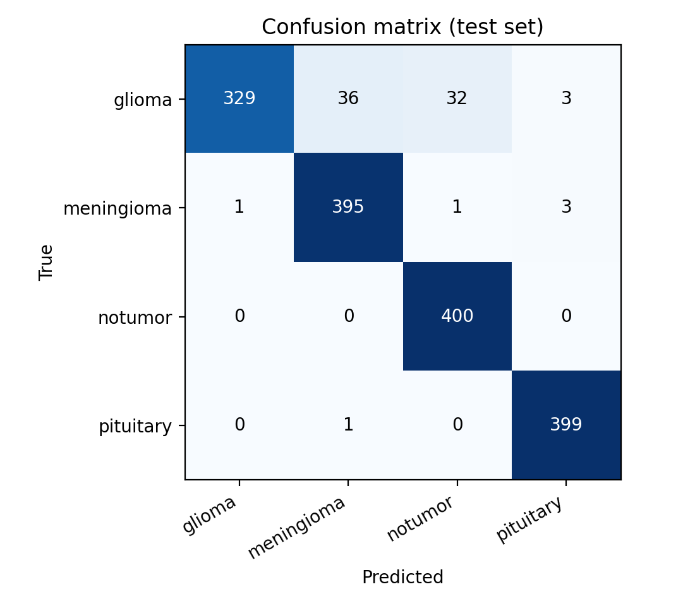
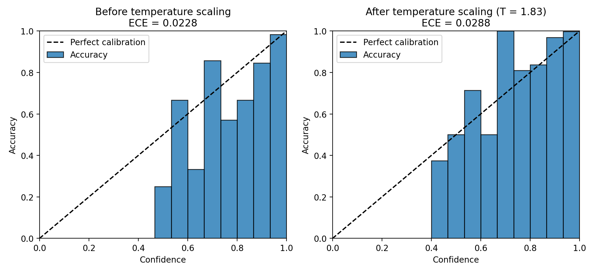

# Explainable Brain Tumor MRI Classification with Uncertainty-Aware Decision Support

An explainable decision-support prototype for four-class brain tumor MRI classification (glioma,
meningioma, pituitary tumor, no tumor), developed as part of research in mathematics and medical AI at
Bahauddin Zakariya University, Multan. Beyond accuracy, the project audits the benchmark for train-test
leakage and measures how well the model's confidence can be trusted.

**Live demo:** [hafzanoor-brain-tumor-classification-agent.hf.space](https://hafzanoor-brain-tumor-classification-agent.hf.space)

## Key findings
- **95.2% test accuracy** (95% CI 94.1–96.2%) on 1,600 held-out images.
- **Train-test leakage:** 582 test images (36.4%) are near-identical copies of training images, including
  88% of the no-tumor class. On the 1,018 clean images, accuracy falls to **92.8%** and macro F1 to **0.892**.
- **Weakest class:** glioma recall is **82.2%** (95% CI 78.3–86.0%); 32 gliomas were predicted as "no tumor".
- **Calibration:** Expected Calibration Error rises from 0.028 to 0.045 on clean images; temperature scaling
  (T = 1.83) reduces negative log-likelihood by 15%.

## Pipeline
1. **Classification:** MobileNetV2 (ImageNet pre-trained) fine-tuned in PyTorch.
2. **Explainability:** Grad-CAM heatmaps on the last convolutional block.
3. **Escalation:** predictions below an adjustable confidence threshold are flagged for human review.
4. **Retrieval:** MiniLM sentence embeddings and a FAISS index retrieve background facts for the predicted class.
5. **Reporting:** a language model (via Groq) writes a short educational report from the retrieved facts only.

## Method

### Classifier
Each 2D slice is resized to 224 × 224 and normalized with ImageNet statistics. The MobileNetV2 backbone
produces features $h(x)$, and a new head (dropout 0.3, linear layer) outputs logits $z = Wh(x) + b$ for
$K = 4$ classes. Fine-tuning uses the standard multi-class cross-entropy objective

$$
\mathcal{L}(\theta) = -\frac{1}{N}\sum_{i=1}^{N} \log \hat{p}_{i,y_i},
\qquad \hat{p}_i = \mathrm{softmax}(z_i).
$$

### Grad-CAM
For class $c$ with score $y^c$ and feature maps $A^k$ of the last convolutional layer, the channel weights
are the spatially averaged gradients, and the heatmap is their weighted, rectified sum:

$$
\alpha_k^c = \frac{1}{Z}\sum_{i}\sum_{j}\frac{\partial y^c}{\partial A^k_{ij}},
\qquad
L^c_{\text{Grad-CAM}} = \mathrm{ReLU}\Big(\sum_k \alpha_k^c A^k\Big).
$$

$L^c$ is upsampled to the input size and overlaid on the scan. It shows where the model looked, not a
tumor segmentation.

### Calibration
Predictions are grouped into $M = 15$ equal-width confidence bins $B_m$. Expected Calibration Error is the
weighted gap between accuracy and confidence:

$$
\mathrm{ECE} = \sum_{m=1}^{M}\frac{|B_m|}{n}\,\big|\,\mathrm{acc}(B_m)-\mathrm{conf}(B_m)\,\big|.
$$

**Temperature scaling** divides the logits by a single scalar $T > 0$. $T$ is fitted on one half of the
test set by minimizing negative log-likelihood (a one-dimensional convex problem) and evaluated on the other half:

$$
\hat{p}_i(T) = \mathrm{softmax}(z_i / T),
\qquad
T^{*} = \arg\min_{T>0}\; -\sum_{i}\log \hat{p}_{i,y_i}(T).
$$

### Leakage audit
Each image is reduced to a 64-bit difference hash (dHash): the grayscale image is resized to 9 × 8 and each
bit records whether a pixel is brighter than its right-hand neighbour. For every test image, the nearest
training image by Hamming distance $d_H$ is found. A pair is a **confirmed duplicate** if

$$
d_H \le 8 \quad\text{and}\quad \rho \ge 0.95,
$$

where $\rho$ is the Pearson correlation between the two images resized to 64 × 64. The second condition
removes scans that merely look alike. All metrics are reported on the full test set and on the clean subset.

### Uncertainty of the estimates
95% confidence intervals use the non-parametric bootstrap: the $n$ test images are resampled with
replacement $B = 2000$ times, each metric is recomputed on every resample, and the 2.5th and 97.5th
percentiles form the interval.

## Results

| Metric | Full test set (n = 1,600) | Clean subset (n = 1,018) |
|---|---|---|
| Accuracy | 95.2% (94.1–96.2) | 92.8% |
| Macro F1 | 0.951 (0.940–0.961) | 0.892 |
| Glioma recall | 82.2% (78.3–86.0) | 81.1% |
| ECE | 0.028 (0.021–0.039) | 0.045 |

Brackets show 95% bootstrap confidence intervals. Run `bootstrap_ci.py --test_dir` to add intervals for the
clean subset.

| Confusion matrix (full test set) | Reliability diagram |
|---|---|
|  |  |

## Reproducing the evaluation
```bash
pip install -r requirements.txt

# 1. Test metrics, calibration and a first duplicate check (saves eval_results/)
python evaluate_model.py --train_dir "PATH/Training" --test_dir "PATH/Testing"

# 2. Confirm duplicates at the pixel level and save example pairs (no model run needed)
python check_duplicates.py --train_dir "PATH/Training" --test_dir "PATH/Testing"

# 3. Bootstrap confidence intervals (add --test_dir for the clean subset)
python bootstrap_ci.py --test_dir "PATH/Testing"
```
The data folders follow the public Kaggle brain tumor MRI dataset layout: `Training/` and `Testing/`, each
with `glioma/`, `meningioma/`, `notumor/` and `pituitary/`.

## Repository structure
```
app.py                 Gradio app (also deployed on Hugging Face Spaces)
tools/                 classifier, Grad-CAM, escalation and retrieval components
models/                trained MobileNetV2 weights and class names
knowledge/             short reference texts used for retrieval
evaluate_model.py      test metrics, calibration and leakage check
check_duplicates.py    pixel-level duplicate confirmation
bootstrap_ci.py        bootstrap confidence intervals
eval_results/          saved metrics, figures and test-set logits
```

## Limitations
- Works on single 2D slices, not 3D volumes.
- The benchmark's test split contains duplicated and augmented copies of images (for example `Te-aug-me_*`),
  so a patient-level split is needed for a fully clean estimate.
- On out-of-distribution scans the model can give low-confidence misclassifications and skewed attention maps.
- Confidence intervals reflect sampling of test images only, not variation across training runs.

## Running the app
Add a `GROQ_API_KEY` secret in the Space settings to enable language-model reports and follow-up questions.
Without it, the app still runs and produces a template report.

> For research and educational use only. Not for clinical diagnosis or patient care.

Author: [Hafza Noor](https://github.com/hafzanoor)
